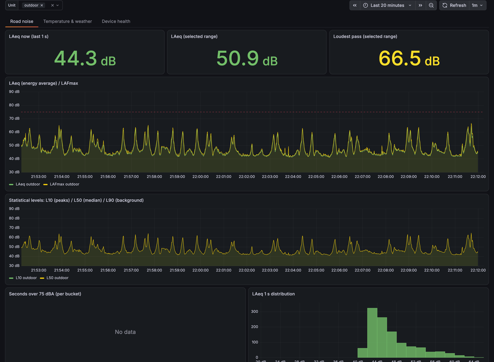
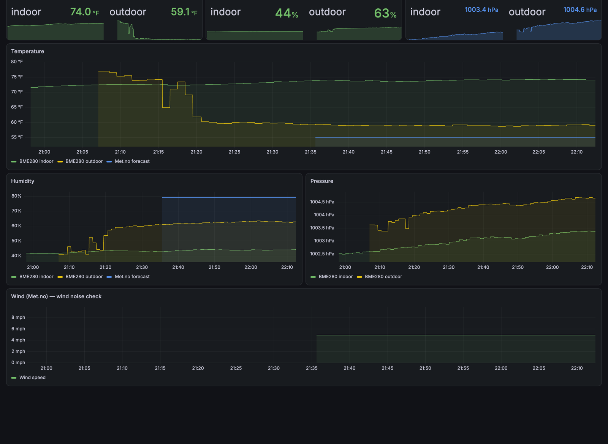

# straight-pipe-logger

Logs how loud passing cars are. ESP32 + INMP441 (A-weighted dB) + BME280 → InfluxDB 1.x (1 s) + Home Assistant (10 min) → Grafana.





## Hardware (per unit)

| Part | Notes |
|---|---|
| ESP32 dev board (ESP-WROOM-32, `esp32dev`) | micro-USB **data** cable for the first flash |
| INMP441 I²S mic | solder the headers; loose pins = garbage readings |
| BME280 (3.3 V, I²C) | optional; logs a warning if missing. BMP280 has no humidity |
| Outdoor: IP65 box, foam windscreen, cable glands, desiccant | mic facing down outside the box; BME280 in a radiation shield |

## Wiring

| Sensor | ESP32 |
|---|---|
| INMP441 VDD / GND / L/R | 3V3 / GND / GND |
| INMP441 WS / SCK / SD | GPIO18 / GPIO23 / GPIO19 |
| BME280 VCC / GND / SDA / SCL | 3V3 / GND / GPIO21 / GPIO22 (I²C 0x76) |

3V3 is one pin: split it (breadboard rail or Y-splice). Mic wires ≤ 20–30 cm.

## Setup

Requires Home Assistant with add-ons **ESPHome**, **InfluxDB** (1.x), **Grafana**, and Python 3.11+.

1. Tools:
   ```bash
   python3 -m venv .venv && source .venv/bin/activate && pip install -r requirements.txt
   ```
2. InfluxDB (Chronograf UI → InfluxDB Admin, or `bin/hactl.py influx`, see `bin/README.md`):
   ```sql
   CREATE DATABASE noise
   ALTER RETENTION POLICY "autogen" ON "noise" DURATION 730d
   CREATE USER esp WITH PASSWORD '...'
   GRANT WRITE ON noise TO esp
   CREATE USER grafana WITH PASSWORD '...'
   GRANT READ ON noise TO grafana
   ```
   One write user per unit (here `esp` = indoor, `esp_outdoor` = outdoor).
3. Secrets: `cp esphome/secrets.example.yaml esphome/secrets.yaml` and fill in (or `bin/make_secrets.sh`).
4. Flash (first time over USB, later over Wi-Fi):
   ```bash
   cd esphome
   esphome run noise-indoor.yaml --device /dev/cu.usbserial-0001     # port: ls /dev/cu.*
   esphome run noise-indoor.yaml --device noise-indoor.local          # OTA
   ```
5. Home Assistant: Settings → Devices → ESPHome device discovered → enter its `api_key` (or `bin/hactl.py add-esphome`).
6. Check: `esphome logs noise-indoor.yaml --device noise-indoor.local` shows `Uploaded 15 + 15 points` every 15 s.
7. Grafana: add InfluxDB data sources, then import dashboards.

   | Data source UID | Database | User | Needed by |
   |---|---|---|---|
   | `influx-noise` | `noise` | `grafana` | both dashboards |
   | `influx-ha` | `homeassistant` | `grafana` | `road-noise-all` (HA InfluxDB integration → db `homeassistant`) |

   | File | Grafana | Import |
   |---|---|---|
   | `grafana/road-noise.json` | any | Dashboards → New → Import |
   | `grafana/road-noise-all.json` | 12+ (`dashboardNewLayouts`, v2 tabs) | `bin/README.md` → "Import a v2 dashboard" |
8. Calibrate: reference meter (e.g. NIOSH SLM app) next to the mic for a few minutes; set `mic_offset` in the unit file (difference in dB); OTA.

## Add a unit

1. `cp esphome/noise-indoor.yaml esphome/noise-<name>.yaml`; set `device_name`, `friendly_name`, `location_tag`, secret names.
2. Add `<name>_api_key`, `<name>_ota_password`, `<name>_influx_auth` to `secrets.yaml`.
3. `CREATE USER esp_<name> ...; GRANT WRITE ON noise TO esp_<name>`.
4. Add `<name>` to the dashboard `unit` variable.

## Troubleshooting

| Symptom | Cause / fix |
|---|---|
| Log: `InfluxDB returned HTTP 401` | wrong user/password, or no `GRANT WRITE` |
| Log: `HTTP 400` | invalid value; firmware skips non-finite values (no mic → −inf) |
| ~90 dBA in a quiet room, −300 dBA dropouts | loose SD/SCK/WS wire or unsoldered mic; then try `channel: right` |
| `bme280 ... Communication failed` | wiring, or address `0x77` instead of `0x76`; only detected at boot |
| HA shows 1 entity instead of 9 | HA Core older than the ESPHome firmware; update HA |
| Wi-Fi signal < −80 dBm | move closer to the AP |

## Layout

| Path | |
|---|---|
| `esphome/noise-common.yaml` | all firmware logic |
| `esphome/noise-{indoor,outdoor}.yaml` | name, tag, credential references |
| `esphome/secrets.example.yaml` | template for git-ignored `secrets.yaml` |
| `bin/` | `hactl.py` (HA/Influx/Grafana admin CLI), `make_secrets.sh`; see `bin/README.md` |
| `grafana/` | dashboard exports |
| `docs/` | screenshots |
| `requirements.txt` | ESPHome CLI + `websockets` |

## Data

| Store | Contents | Retention |
|---|---|---|
| Influx `noise` | measurement `noise`: `laeq_1s`, `lafmax_1s`, tag `location` | 2 y |
| Influx `homeassistant` | HA InfluxDB integration (optional): measurement = unit, tag `entity_id`, field `value` | 180 d |
| HA | LAeq / LAmax / LAmin 10 min, loud events (> 75 dBA), temperature, humidity, pressure, Wi-Fi, backlog | recorder |

Influx write: `http://<influx_host>:8086/write?db=noise&precision=s`, credentials in an `Authorization: Basic` header (ESPHome logs URLs on errors).

## Config

| Setting | Value |
|---|---|
| Sampling | 48 kHz, 32-bit, I²S `channel: left` |
| Upload | every 15 s, ≤ 300 points/series |
| Offline buffer | 2400 s |
| Loud event | LAFmax ≥ 75 dBA, 3 dB hysteresis |
| `mic_offset` | 0 dB (uncalibrated) |

## License

MIT (`LICENSE`). Uses [esphome-sound-level-meter](https://github.com/stas-sl/esphome-sound-level-meter) as an external component.
